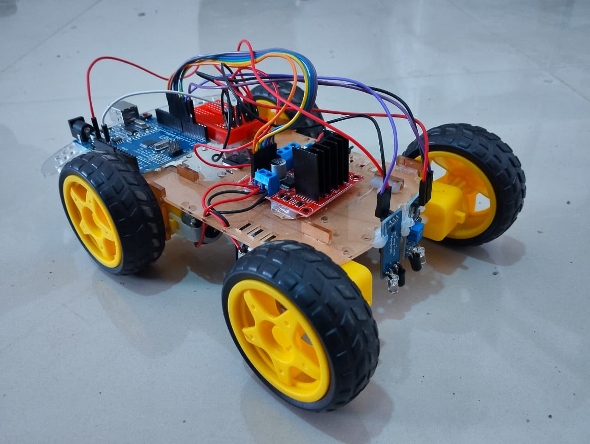
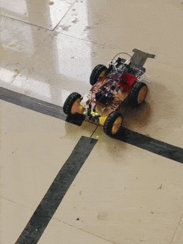

# Line-Following Localization Robot

An autonomous robot that uses two IR sensors to follow a black line grid and localize itself by stopping at grid intersections (line junctions). The robot can navigate to specific coordinates on a grid by following lines and making precise turns at intersections.

## Working Principle

1. **Sensors**

   - Two IR sensors positioned at the front of the robot to detect black lines
   - IR sensors return: White surface = 0, Black line = 1
   - IR sensors are used for both line following and junction detection

2. **Grid Navigation**

   - The robot operates on a grid with lines forming a coordinate system
   - Grid coordinates are defined with an origin point (typically bottom-left)
   - The robot tracks its current position (X, Y) and can navigate to target positions
   - Initial direction is assumed to be NORTH (facing upward from the starting position - SOUTH-WEST)

3. **Control Logic**

   - **Line Following**
     - Both sensors see black → move forward
     - Left sensor sees white → steer right
     - Right sensor sees white → steer left
     - Both sensors see white → intersection detected
   - **Junction Handling**: Robot stops at intersections to update position and decide next move
   - **Direction Alignment**: Robot calculates the required turns to face the target direction (NORTH, SOUTH, EAST, WEST)

4. **Navigation Algorithm**

   - The `gotoStart()` function implements a simple pathfinding strategy:
     - First, align with target column by moving EAST or WEST
     - Then, align with target row by moving NORTH or SOUTH
   - Turns are executed at junctions by:
     - Moving forward slightly past the intersection
     - Rotating in place until the line is detected again
     - Stopping when both sensors detect the line (aligned with new direction)

5. **Turn Execution**:
   - `turnRight()`: Rotates the robot clockwise by running only the left motor
   - `turnLeft()`: Rotates the robot counterclockwise by running only the right motor
   - Turn completion is detected when both IR sensors see the line again after leaving it

### Pin Configuration

- **IR Sensors**: Digital pins 4 (left) and 5 (right)
- **Motor Driver**: PWM pins 10-11 for speed control, digital pins 6-9 for direction control

## Demo

## Problems Faced

- **IR Sensor Calibration**: Ensuring consistent black/white detection across different lighting conditions and surface materials required careful threshold tuning for the IR sensors.
- **Power Supply Issues**: Inadequate power supply caused inconsistent motor performance and unreliable sensor readings. A stable power source was critical for smooth operation.
- **Turn Accuracy at Junctions**: Achieving precise 90° turns proved challenging due to time-based control:
  - The robot must move slightly forward past the junction before initiating a turn
  - Turn timing is environment-dependent and requires recalibration when tested on different surfaces or grid layouts
  - Motor speed variations and surface friction affect turn consistency
- **Bumpy Movement and Flickering**: The robot exhibited significant oscillation and flickering during line following due to time-based calibration delays. This remained an ongoing issue as the fixed delay approach couldn't adapt to varying conditions.
- **Direction State Management**: Maintaining accurate direction tracking (NORTH, SOUTH, EAST, WEST) throughout multiple turns and movements required careful state management to prevent navigation errors accumulating over time.

## Assumptions

- The robot starts at a known position with a known orientation (facing NORTH by default)
- The grid consists of continuous black lines on a white surface with clear (white) intersections
- Grid coordinates increase NORTH (upward) for X and EAST (rightward) for Y
- The surface is flat and provides sufficient contrast for IR sensors to distinguish lines
- IR sensors are properly calibrated to detect black lines (returning 1 for black, 0 for white)
- No obstacles exist between the current position and target position on the grid
- The robot operates in an environment with consistent lighting conditions
- The navigation algorithm assumes an unobstructed path and follows a simple "column-first, then row" strategy, which may not always be the shortest path.
